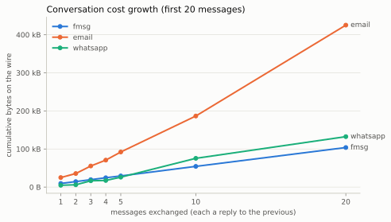
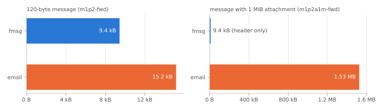

# Over the wire: Email vs. WhatsApp vs. fmsg

<time datetime="2026-11-01">1 November 2026</time> · Originally published on <a href="https://fmsg.ai/blog/over-the-wire">fmsg.ai</a>

I conducted empirical tests of how much data email, WhatsApp and fmsg sent and received for the same messages. My conceit, naturally, was to present trustworthy charts showing fmsg (a protocol I’v been developing for some time) has the efficiency of IM apps but can be self-hosted like email, i.e. the best of both worlds. Although there was always that little feeling you don’t really know till you measure, and, when you do measure you often find things you hadn’t thought of. True to this inkling I did discover some things, namely; WhatsApp is doing some gnarly image compression, email’s relaying is more cause for concern than I realised, and, the real savings from fmsg is due to statefulness – not individual messages sizes – despite my focus on minimising message size using compact binary encoding.

## The Setup

The full test suite, results and source are over at <https://github.com/markmnl/fmsg-bench>. Email and fmsg are hosted at the domain level, I chose three hosts for each. Email a self-hosted mailcow (which uses Postfix) I could do measuring on, and the next two most popular providers: Gmail and Outlook. For fmsg I ran three hosts across continents – my self-hosted bare metal box, a GCP and Digital Ocean VM, all using the OSS stack with fmsgd: <https://github.com/markmnl/fmsgd>. WhatsApp is a bit different with no control of the host (everything goes to Meta’s servers) so I used whatsapp-web.js with linked accounts – a bit dubious at best.

<figure class="article-figure" markdown="span">
  { width="2079" height="1066" loading="lazy" }
  <figcaption>Figure 1: Hosts setup</figcaption>
</figure>

## Highlights

First the basics, how bytes over the wire looked like with typical message exchanges. Email grows because the tests mimicked what all email clients typically do – include prior content in each email – to be fair SMTP has no such requirement. However email is stateless so without knowing if the recipients still hold prior mail they just add this history each time..

<figure class="article-figure" markdown="span">
  { width="657" height="373" loading="lazy" }
  <figcaption>Figure 2: Conversation growth</figcaption>
</figure>

This was for the same conversation, see the detail in the linked GitHub repo which also details the method which used tcpdump into .pcap file.

### WhatsApp’s gnarly image compression

Funnily I’ve always rated WhatsApp for sending images compared to say Messenger because the images seem to stay visibly sharp whereas I notice they visually degrade in Messenger. I always just assumed that was probably due to Messenger resizing and using more lossy compression. Well WhatsApp is doing *something* to images (so kudos them because visually I hand’t noticed):

<figure class="article-figure" markdown="span">
  { width="707" height="500" loading="lazy" }
  <figcaption>Figure 3: Attachment sizes</figcaption>
</figure>

As you can see the .png and .jpg are radically reduced by WhatsApp somehow!? I’m still not sure how – it must be something proprietary that is then reversed because normal images come out the other end..

### Email’s relaying is cause for concern

During an earlier round of testing I realised I still had a email relay configured which I had setup for my self-hosted email. Reason I have the relay is as a residential customer, my ISP would not allow me to configure the reverse DNS (PTR) record for my public IP address – used by email for anti-spam controls – so had to use an email relay for reliable delivery. This experience drove home a realisation: *a relay terminates your connection so there goes TLS if you were relying on that*! You’re placing a lot of trust in your relay which could silently eavesdrop all mail passing through it. fmsg’s direct host-to-host requirement prevents relaying and has no requirements outside my control, like the reverse DNS record, making self-hosting fmsg more viable and secure for me than email. Relaying hides total bytes over the wire because regardless of the number of recipients everything goes to the relay first then fans-out. So I had to turn off the relay, trust the mail on recipients side then measure again.

### fmsg’s statefulness

In fmsg hosts have to hold the parent message being replied to (a directed acyclic graph of hash linked messages builds up) otherwise the message is rejected. This helps prove prior participation in a thread and prevent spam. It also means adding additional recipients to a message a host already holds only needs the header – because messages are immutable and the host already holds it, e.g. if @bob@example.com is added to a message from @alice@acme.com to @carol@example.com, during transmission example.com detects it already has this message and only needs to record @bob is an additional recipient. This is fully described in the fmsg specification. This point bangs home the below test’s visualisation:

<figure class="article-figure" markdown="span">
  { width="860" height="243" loading="lazy" }
  <figcaption>Figure 4: Marginal cost of adding a participant (same recipient domain)</figcaption>
</figure>

## Passing thoughts

Overall I’m happy how fmsg is performing and feel at the practical limit of optimising messages exchanged. In other news fmsg is now officially registered with the IANA on TCP 4930: <https://www.iana.org/assignments/service-names-port-numbers?search=4930> and we have an fmsg MVP hosting provider up at [fmsg.ai](https://fmsg.ai/) – claim your fmsg address today! Or self-host – a full back-end OSS stack is available at: <https://github.com/markmnl/fmsg-docker>

Mark
